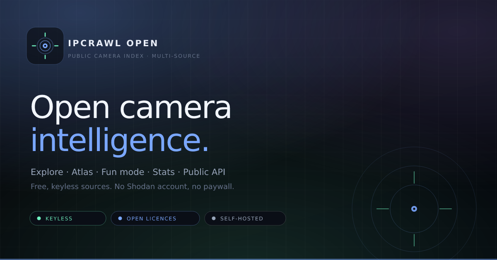

# IPCrawl Open

**A public-camera index you can run yourself — no API keys, no paid tier, no Shodan account.**

This is a rebuild of [alectrocute/ipcrawl](https://github.com/alectrocute/ipcrawl). It keeps the
original's shape — Explore, Fun Mode, Atlas, Stats, a documented API, an "is my camera exposed?"
check — but replaces the single paid search index with **free, keyless data sources**.

It ships with 85 curated records, so the site is fully browsable the moment it starts, even on a
machine with no internet.



---

## Quick start

**You need:** Node.js **22.5 or newer** (the app uses the built-in `node:sqlite` module) and npm.

```bash
git clone https://github.com/davhhyn/ipcrawleng.git
cd ipcrawleng
npm install
npm run dev
```

Open **http://localhost:3000**. That's it — first boot creates `./.data/ipcrawl.sqlite`, applies
the schema and loads the bundled catalogue. `Ctrl+C` stops it.

### Other ways to get it

**Download a ZIP** (if you don't have git): on the repository page click **Code → Download ZIP**,
unzip it, then open a terminal in that folder and run:

```bash
npm install
npm run dev
```

**Docker** (nothing to install but Docker):

```bash
docker compose up --build     # http://localhost:3000
```

The catalogue lives in the `ipcrawl-data` volume, so it survives restarts. `docker compose down`
stops it; add `-v` to wipe everything.

### If something goes wrong

| Symptom | What to do |
| --- | --- |
| `ERR_UNKNOWN_BUILTIN_MODULE: node:sqlite` | Your Node is too old — install 22.5+ (`node --version`) |
| `EADDRINUSE: port 3000` | Something else owns the port: `npm run dev -- --port 3001` |
| `Another Nuxt dev server is already running` | This app is already running — open http://localhost:3000, or `kill <PID>` and restart |
| The page loads but shows no new cameras | Expected offline. The 85 seed rows still render; `npm run check:sources` says which feeds are reachable |
| You want a clean slate | Stop the app and delete `./.data` |

### Pulling live listings

Once the machine can reach the internet:

```bash
curl -X POST http://localhost:3000/api/sources/sync
```

In `npm run dev` this endpoint is open. If `NUXT_SYNC_TOKEN` is set it needs a Bearer token
instead. In production the daily scheduled refresh (03:15) does this for you and you can leave the
endpoint closed.

---

## What's in it

| Page | Route | What it does |
| --- | --- | --- |
| **Explore** | `/` | The catalogue. Search, plus filters for status, source, country, city, vendor, kind and favourites. Paginated, thumbnails per card, detail dialog with map, probe history and a copyable link. |
| **Camera page** | `/cam/:id` | One real, shareable, server-rendered page per camera: canonical URL, Open Graph image, JSON-LD, full provenance and liveness history. |
| **Atlas** | `/map` | SVG world map with clustered markers — bundled geometry, no tile server. Zoom, drag, filter by source, synced side list. |
| **Fun Mode** | `/fun` | A CRT-styled channel hopper. `←/→` or `space` to change channel, `g` to guess where you are, `l` for live-only, `f` to favourite. Channel URLs are shareable. |
| **Stats** | `/stats` | Coverage by country, source, vendor and kind, plus a history chart. |
| **Sources** | `/sources` | Every provider with its licence, last run and contribution count. |
| **API** | `/api` | Interactive docs for every endpoint, with copy-paste examples. |
| **IMCE** | `/imce` | "Is my camera exposed?" — checks the caller's public address against the index. |
| **About** | `/about` | Architecture, provenance, licences, ground rules. |
| **SEO** | `/sitemap.xml` · `/robots.txt` | Generated sitemap of every indexed camera; crawl policy keeps bots off the frame proxy and write endpoints. |

Two promises the UI keeps:

- **It never fakes liveness.** Every record is `live`, `offline`, `unknown` or `page`. A frame that
  can't be fetched is drawn as a clearly stamped illustration — `FRAME NOT LIVE · ILLUSTRATIVE` —
  never as a silent blank.
- **Seed rows stay labelled.** The bundled dataset is marked `SEED` in the UI, in the API and on
  every generated frame.

---

## How it works

Three layers, one database.

```
Browser  (Nuxt 4 · Vue 3.5 — server-rendered pages, hydrated islands)
   │
   ▼
Nitro server (Node)
   ├── read path    /api/explore/*  ·  /api/stats  ·  /api/sources   ──► SQLite
   └── write path   /api/sources/sync  ──► ingest pipeline            ──► SQLite
                                              │
                                              ├─ providers   osm · tfl · digitraffic · windy
                                              ├─ normalize   derive kind/vendor/country, drop private hosts
                                              ├─ dedupe      same stream → most authoritative source
                                              ├─ upsert      batched; stale rows deactivated
                                              ├─ probe       bounded fetch, records HTTP outcome
                                              └─ snapshot    totals appended to history
```

**The read path** is plain queries. `exploreStore.ts` owns list/facet/map queries with their filters
and paging; `catalogStore.ts` owns status, stats and the source table. Everything is server-rendered
first — every page returns complete HTML, then the interactive parts hydrate.

**The write path** is one single-flight pipeline (`server/utils/ingest/pipeline.ts`):

```
discover  →  normalize  →  dedupe  →  upsert  →  probe  →  snapshot
```

1. **Discover** — every enabled provider runs concurrently and is capped per run.
2. **Normalize** — URL, scheme, kind, vendor and country are derived; private/loopback hosts are rejected here.
3. **Dedupe** — the same stream seen by two providers collapses to the most authoritative one
   (`curated → tfl → digitraffic → windy → osm`).
4. **Upsert** — batched into SQLite; a source's stale rows are deactivated, but only by a run that
   actually returned data.
5. **Probe** — a bounded, budget-limited fetch checks which streams really answer and records HTTP outcomes.
6. **Snapshot** — totals are appended to a history table (60-day retention) for the Stats chart.

A second `POST /api/sources/sync` while one is running gets `409`, not two scrapers racing.

**Where the images come from:** `frames.ts` proxies the upstream frame (so raw stream hosts never
appear in the public API), caches thumbnails, and falls back to `syntheticFrame.ts` — a deterministic
SVG scene rendered from the camera id, always stamped as illustrative.

### Module map

| Path | Owns |
| --- | --- |
| `app/` | Pages, components, composables, the design system (Tailwind 4 + hand-built tokens) |
| `layers/explore/` | `/api/explore/*` — list, detail, facets, thumb, frame, favourite |
| `layers/map/` · `layers/fun/` · `layers/imce/` | Atlas points, Fun channels, exposure check |
| `shared/` | Contracts used by both sides: routes, sources, query parsing, geo data |
| `server/utils/ingest/` | Provider adapters, normalisation, dedupe, pipeline |
| `server/utils/` | `db` · `camStore` · `exploreStore` · `catalogStore` · `probe` · `frames` · `schema` |
| `server/tasks/` | The scheduled `cams:refresh` task |
| `sensor/` | The local sensor: authorization gate, port probing, fingerprints, dataset import |
| `data/curated-cams.json` | The bundled 85-record catalogue |
| `migrations/` | Documented schema (also applied idempotently at runtime) |

---

## Where the data comes from

| Provider | Kind | Key | Licence | Coverage |
| --- | --- | --- | --- | --- |
| **Open Camera Index** (`curated`) | seed | — | per-camera attribution | Global, 85 documented feeds |
| **OpenStreetMap** (`osm`) | discovery | — | ODbL 1.0 | Global, community-mapped |
| **TfL JamCams** (`tfl`) | discovery | — | Open Government Licence v3 | London |
| **Fintraffic** (`digitraffic`) | discovery | — | CC BY 4.0 | Finland |
| **Windy Webcams** (`windy`) | discovery | optional free key | Windy ToS | Global, opt-in |
| **InternetDB** (`internetdb`) | enrichment | — | Shodan public data | Tags/vendor only |
| **Local sensor** (`sensor`) | discovery · local | — | your declared scope | Networks you allowlist |
| **Dataset import** (`import`) | discovery · local | — | your dataset | Whatever you point it at |

**None of them is load-bearing.** Any source can fail, rate-limit or vanish and the catalogue keeps
serving; the sync reports per-source status instead of failing as a whole. Windy is the only one that
*can* use a key, and it is off by default — nothing degrades if you never set one.

### What "ingest" actually means

The providers hand you **URLs that operators already published**: TfL's JamCam API, Fintraffic's
road-weather stations, OpenStreetMap's `tourism=webcam` and `contact:webcam` tags. The app fetches
those URLs to check they answer. It does **not** scan IP ranges, enumerate ports, or guess URLs — and
it will not find cameras nobody has documented.

`internetdb` is the one Shodan-derived source: free, keyless, allowed only to *annotate* a host
another source already found. It can never create a listing.

If you want the other kind of discovery — sweeping your own network for open cameras — that's the
optional local sensor below.

### Checking reachability before trusting a sync

```bash
npm run check:sources
```

It performs the same request each provider would, directly — no Nuxt, no database, nothing written —
and tells you what a sync would pull. On an offline machine it looks like this:

```
  osm           ✗  unreachable (DNS/network)  keyless
  tfl           ✗  unreachable (DNS/network)  keyless
  windy         –  no NUXT_WINDY_API_KEY set (optional)
  sensor        –  local — run `npm run sensor -- status`

  No discovery source could be reached from this machine.
```

With internet, each becomes a `✓` with a count and a sample name. `--strict` exits non-zero when
nothing is reachable, for deploy preflights.

---

## Local sensor — your own Shodan, on your own network

Shodan is an index of the whole internet, built by sweeping it continuously. You can't reproduce that
from a laptop, and the sweep is the part you wouldn't want to reproduce. But the genuinely useful
part — open ports, service banners, page titles, auth realms — can be collected locally from networks
you name:

```bash
npm run sensor -- init                              # writes sensor.allowlist.json (gitignored)
npm run sensor -- scan --cidr 192.168.1.0/24 --dry-run
npm run sensor -- scan --cidr 192.168.1.0/24        # needs NUXT_SYNC_TOKEN in the app
npm run sensor -- import --file shodan-export.jsonl # index a dataset you already own
npm run sensor -- status
```

- **Scope is a file.** Every target must be covered by `sensor.allowlist.json`. A missing file fails
  closed, blocks wider than `/16` are refused, and a run is capped at 4096 addresses. Public ranges
  need four independent opt-ins: the allowlist entry, `publicAllowed`, `--allow-public` and `--yes`.
- **No credentials, ever.** One anonymous `GET` on a handful of documented camera paths, one RTSP
  `OPTIONS`. A `401` is recorded as evidence, not attacked.
- **Nothing leaves the machine.** Results POST to `/api/sensor/ingest` on your own app (loopback +
  token), land in the same SQLite database, tagged `source=sensor`. No telemetry, no upload.
- **The endpoint cannot scan.** It only stores, so an exposed instance never becomes an open scanner.

Full walkthrough, limits and legal notes: **[docs/LOCAL-SENSOR.md](docs/LOCAL-SENSOR.md)**.

---

## API

Read-only, CORS-open, no key. Rate limited per IP.

| Method | Endpoint | Purpose |
| --- | --- | --- |
| `GET` | `/api/status` | Catalogue health, counts, last sync |
| `GET` | `/api/health` | Liveness probe + effective runtime flags |
| `GET` | `/api/stats` | Aggregates by country/source/vendor/kind |
| `GET` | `/api/stats/history` | Snapshot time series |
| `GET` | `/api/sources` | Providers, licences, last run |
| `POST` | `/api/sources/sync` | Trigger ingestion (`409` if already running) |
| `GET` | `/api/explore/cams` | Search + facet filters, paginated |
| `GET` | `/api/explore/cams/:id` | One camera with probe metadata |
| `GET` | `/api/explore/facets` | Facet counts for the current query |
| `GET` | `/api/explore/thumb/:id` | Cached thumbnail (SVG fallback) |
| `GET` | `/api/explore/frame/:id` | Full frame, `no-store` |
| `POST` | `/api/explore/favorite/:id` | Toggle a favourite (cookie/pepper hashed) |
| `GET` | `/api/map/points` | Markers for the atlas |
| `GET` | `/api/fun/cam` | Random channel |
| `GET` | `/api/fun/cam/:id` | Specific channel |
| `GET` | `/api/ip` · `/api/imce/check` | Address exposure check |
| `POST` | `/api/sensor/ingest` | Local sensor ingest (token + loopback) |
| `GET` | `/api/sensor/status` | What the sensor has stored |

Query parameters accept both repeated (`?country=IT&country=JP`) and bracketed (`?country[]=IT`)
forms. Paging is clamped server-side: `pageSize` never exceeds 60.

The running app's `/api` page has request/response examples for each one.

---

## Safety and ground rules

This project indexes **publicly documented** cameras. No provider scans address ranges, guesses
credentials, or bypasses authentication.

- **No LAN or loopback ingestion from providers.** Private, loopback, link-local, `.local`,
  `.internal` and `.home.arpa` hosts are rejected at normalization, again on every redirect hop, and
  DNS answers are re-checked to block rebinding.
- **The only private-network rows are yours.** Cameras found by `npm run sensor` may point into your
  LAN; they reach the frame proxy only for `source=sensor`, only at RFC1918/loopback addresses
  (never link-local or cloud metadata), and never through a hostname.
- **Local scanning is opt-in and scoped** — see [docs/LOCAL-SENSOR.md](docs/LOCAL-SENSOR.md).
- **No credentials, no exotic schemes.** URLs with userinfo, or non-HTTP(S) schemes, are dropped.
- **Bounded fetching.** Timeouts, a byte cap, a redirect cap and a per-sync probe budget keep a
  hostile upstream from stalling a run.
- **Takedowns are config.** `NUXT_BLOCKED_HOSTS` takes host suffixes and `source:<id>` entries,
  applied before a record ever reaches SQLite.

If you deploy this, you're responsible for the feeds you point it at. Respect each provider's terms,
keep the attribution, and honour takedown requests.

---

## Configuration

Copy `.env.example` and edit. The ones that matter:

| Variable | Default | Meaning |
| --- | --- | --- |
| `NUXT_DATA_DIR` | `./.data` | Root for the DB, thumbnails and cache (**build-time**) |
| `NUXT_DB_PATH` | `$NUXT_DATA_DIR/ipcrawl.sqlite` | SQLite location |
| `NUXT_SYNC_SOURCES` | `curated,osm,tfl,digitraffic,internetdb` | Provider allow-list |
| `NUXT_SEED_DEMO` | `true` | Load the bundled catalogue on first boot |
| `NUXT_SYNC_TOKEN` | — | Bearer token for sync **and** local sensor ingest |
| `NUXT_ALLOW_PUBLIC_SYNC` | `false` | Allow unauthenticated sync outside dev |
| `NUXT_ENABLE_LIVE_PROBE` | `true` | Probe feeds for liveness |
| `NUXT_WINDY_API_KEY` | — | Optional free-tier key |
| `NUXT_OVERPASS_URL` | `overpass-api.de` | Overpass mirror or proxy |
| `NUXT_BLOCKED_HOSTS` | — | Host suffixes / `source:<id>` to never publish |
| `NUXT_VOTER_PEPPER` | — | Salt for hashed favourite voters |
| `NUXT_PUBLIC_SITE_URL` | `http://localhost:3000` | Canonical URL for metadata |

Sensor-specific flags are documented in [docs/LOCAL-SENSOR.md](docs/LOCAL-SENSOR.md).

---

## Development

```bash
npm run dev            # dev server
npm run typecheck      # vue-tsc, strict
npm run test:unit      # vitest
npm run test:ingest    # end-to-end ingestion against a local fixture
npm run build          # production build
npm run verify         # typecheck + unit + ingest + build
npm run check:sources  # probe each provider; --strict to fail when offline
npm run sensor         # local sensor CLI (see docs)
```

`npm run verify` is the whole gate in one command. CI runs the same sequence, plus a production-bundle
smoke test and a Docker build.

`npm run test:ingest` is the interesting one: it boots a fixture HTTP server that mimics TfL,
Fintraffic and Overpass, points the real pipeline at it, and asserts what actually reached SQLite —
dedupe priority, private-host rejection, URL-less rows dropped, HLS detection, live/offline probing,
JPEG proxying, facet counts and map points. It uses ephemeral ports and its own database, so it can
run next to a dev server.

---

## Deployment

The production build is a plain Nitro node-server bundle:

```bash
npm run build
node .output/server/index.mjs      # PORT, HOST, NUXT_DATA_DIR, NUXT_PUBLIC_SITE_URL
```

`NUXT_DATA_DIR` is read at **build** time (it sets the thumbnail and cache roots), so set it before
building if you're mounting a volume. The Docker image already bakes in `/data`.

Set `NUXT_PUBLIC_SITE_URL` in any real deployment — it drives canonical links, `og:image`, the
sitemap and `robots.txt`. Leave `NUXT_SYNC_TOKEN` unset and let the scheduled task fetch; expose the
sync endpoint only if an operator needs to trigger a run by hand.

`GET /api/health` is the liveness probe: it touches neither the network nor the rate limiter and
reports the effective source list, so a misconfigured deployment is obvious from a single `curl`.

---

## Differences from upstream ipcrawl

Kept: layered structure, route and contract shape, Explore/Fun/Atlas/Stats/API/IMCE surfaces, SQLite
persistence, scheduled refresh, daily snapshots.

Changed deliberately:

- **No Shodan dependency.** Five free providers (four discovery, one enrichment) instead of one paid
  index; the app is useful with zero keys and zero network.
- **No external tile server.** The atlas uses bundled world geometry, so it works offline.
- **No CDN icons or fonts.** Everything is local; no runtime requests to third-party asset hosts.
- **Bundled seed catalogue,** so first run is never an empty page.
- **Per-camera pages** (`/cam/:id`) with real SEO metadata, so the catalogue is linkable and indexable.
- **Generated illustration frames** instead of a blank "no signal" box, always stamped as non-live.
- **Tailwind 4 with a hand-built token layer** instead of Nuxt UI — same utility workflow, far
  smaller dependency surface.
- **An optional local sensor** so the Shodan-shaped workflow (ports, banners, titles) is available on
  networks you own.

## Credits

- Concept and original implementation: [alectrocute/ipcrawl](https://github.com/alectrocute/ipcrawl) (MIT).
- Map geometry: [Natural Earth](https://www.naturalearthdata.com/) via `world-atlas` (public domain);
  country metadata via `world-countries` (ODbL).
- Camera data: Transport for London, Fintraffic, OpenStreetMap contributors, Windy, and the individual
  operators listed per record in the catalogue.

If you use this project, keep the upstream credit and the per-source licences intact.

MIT.
